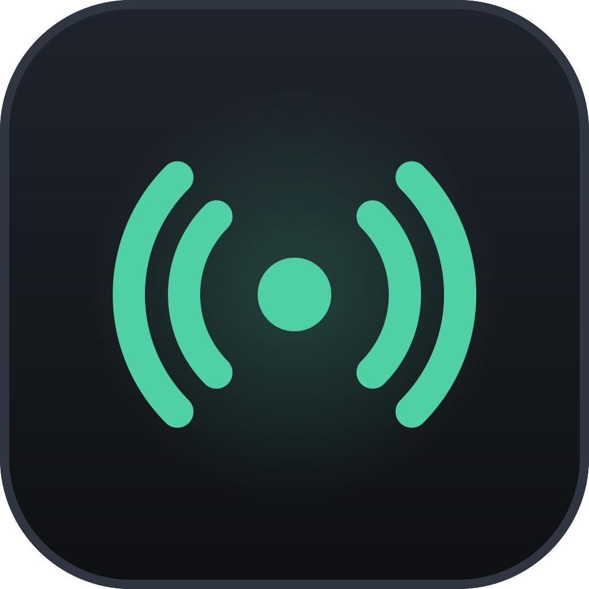
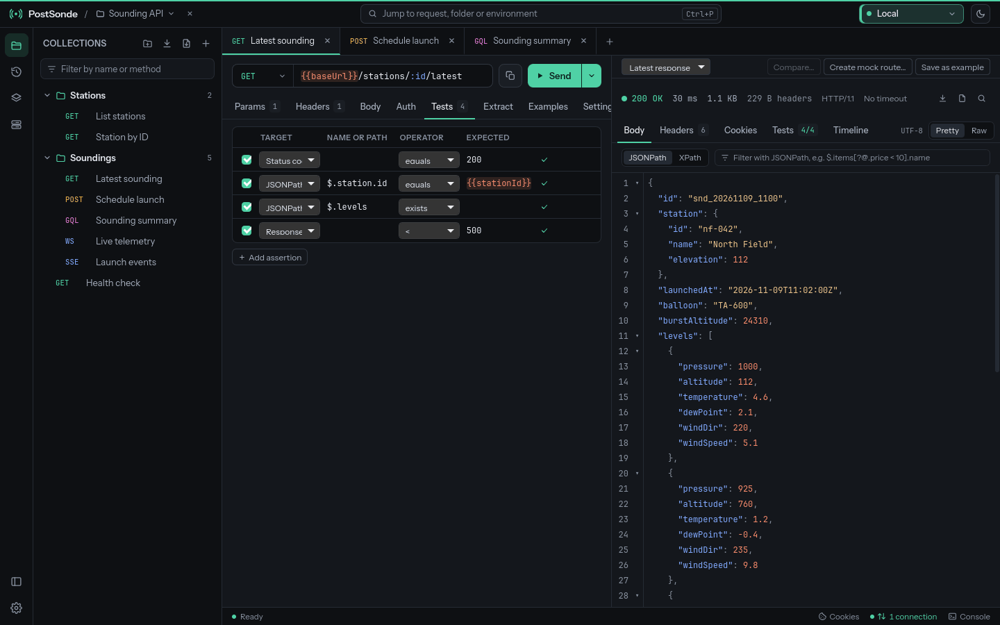

<div align="center">



# PostSonde

**A desktop client for testing HTTP, GraphQL, gRPC and socket APIs, with no account and no cloud.**

[What it does](#what-it-does) · [Where it stands](#where-it-stands) · [Install](#install) ·
[Build it yourself](#build-it-yourself) · [Documentation](#documentation) ·
[What it is made of](#what-it-is-made-of) · [Who made it](#who-made-it) ·
[Contributing](#contributing) · [License](#license)

</div>

<picture>
  <source media="(prefers-color-scheme: light)" srcset="docs/screenshots/request-light.png">
  
</picture>

PostSonde sends and tests requests over HTTP, GraphQL, gRPC, WebSocket, Socket.IO,
Server-Sent Events, and raw TCP and UDP. It can also play the server side, so that a
client under test has something local to talk to. It does the everyday work of clients
like Postman, Insomnia or Altair, without accounts or cloud sync.

A project is a folder of JSON files, one per request, that you can open in an editor and
keep in git. There is no login and no trial, and nothing depends on a hosted service. The
app opens no connection you didn't ask for: no telemetry, no crash reports, no update
checks, not even a web font. [PRIVACY.md](PRIVACY.md) lists every kind of connection it
makes, and when.

The interface runs in the web view your system already has (WebKitGTK on Linux, WKWebView
on macOS, WebView2 on Windows), not in a bundled browser engine. PostSonde is free software
under the MIT License.

## What it does

HTTP requests take any method, QUERY and custom ones included, with query and path
parameters, headers, and JSON, XML, YAML, form, multipart or file bodies. The response
pane pretty-prints the body and filters it with JSONPath or XPath. It also shows the
headers, the cookies, and a timeline with the request exactly as it went out and the time
split into DNS, connect, TLS, waiting and download. Large responses stream to disk. A
response can be kept as an example, or compared with an earlier one.

GraphQL requests take their schema from introspection or from an SDL file. The editor
uses it to validate the query and to autocomplete it, and a docs explorer lets you browse
it. Subscriptions run over graphql-transport-ws, the older subscriptions-transport-ws
protocol, or Server-Sent Events. File uploads and `@defer`/`@stream` responses work too.

gRPC calls work from `.proto` files, which PostSonde parses itself without `protoc`, or
from server reflection. Unary, server-streaming, client-streaming and bidirectional calls
are supported, with metadata, deadlines and the error details a server sends back.
Messages are written and shown as JSON. WebSocket, Socket.IO (v2 to v4), SSE, TCP and UDP
each have an editor and a log of what was sent and received.

PostSonde can also listen. There are mock HTTP servers with routes and templated
responses, which you write by hand or generate from an OpenAPI document or a response you
received. There is an echo server, a webhook receiver that can replay what it caught, and
WebSocket, Socket.IO, SSE, TCP, UDP, gRPC and GraphQL servers. They listen on 127.0.0.1
unless you pick another address.

Auth covers Basic, bearer tokens, API keys, Digest, OAuth 1.0, OAuth 2.0 (client
credentials, authorization code with PKCE through your browser, password and implicit),
JWTs signed when the request is sent, AWS Signature Version 4, Hawk and `.netrc`. A
folder's auth applies to the requests in it, and WebSocket, Socket.IO and gRPC handshakes
carry it too. Client certificates for mutual TLS are set per host.

Environments, global variables and folder variables fill `{{placeholders}}` anywhere in a
request, along with dynamic values such as `{{$uuid}}` and the last response of another
request. Secret values stay out of the project folder, in PostSonde's own data directory,
which you can encrypt with a master password.

Tests are rows of target, operator and expected value, with no scripting. They check the
status, headers, cookies, JSONPath and XPath results, the body, the time or the size, and
can validate JSON against a JSON Schema. Extraction rules carry values from one response
into the next request. The folder runner sends a folder's requests in order, as many times
as you ask or once per row of a CSV or JSON file, and saves a report as JUnit XML, JSON or
HTML.

Import reads cURL commands, Postman collections and environments, Insomnia exports,
OpenAPI 3 and Swagger 2.0 documents, HAR files and Altair exports. A request can be
copied as a cURL command for a POSIX shell, cmd or PowerShell, as an HTTPie or wget
command, as raw HTTP, or as code for JavaScript `fetch`, Python `requests`, Go, Java or
C#.

Every connection goes through one dialer, so a proxy (SOCKS5, SOCKS4 or HTTP, taken from
the system settings or set for the app, a project or an environment) and extra CA
certificates apply to every protocol, and the console can list each connection the app
opens. Each request you send goes into a local history with a copy of its response,
secrets masked.

There are light, dark and custom themes, a command palette (Ctrl+Shift+P, ⇧⌘P on a Mac),
shortcuts you can change, and several windows. The interface is in English.

## Where it stands

PostSonde 1.0.0 is the first release, and everything above is in it. Download it from
the [latest release](https://github.com/sorrelfox/postsonde/releases/latest).

Linux is where PostSonde is developed and tested. On Fedora 44 with KDE Plasma, a
`strace` run confirmed that the app opens no connection of its own, online or offline
([docs/privacy.md](docs/privacy.md#results)). The start time and memory figures in
[docs/footprint.md](docs/footprint.md) come from the same machine, a fast desktop: the
GTK 4 build opened its window in about 280 ms and idled at about 190 MiB, most of it
WebKit.

The release workflow installs every package in a clean system and starts the app: the
Linux packages on x86-64 and ARM64, the macOS app on an Intel Mac runner, and the Windows
installers on x64 and ARM64 runners. Beyond that, PostSonde hasn't been used on a real Mac
or Windows PC yet. Expect rough edges there, and please
[report](https://github.com/sorrelfox/postsonde/issues) what you find.

| System | Web view | Builds for | State |
|---|---|---|---|
| Linux | WebKitGTK 6.0 (GTK 4), or WebKit2GTK 4.1 (GTK 3) for Ubuntu 22.04 and Debian 12 | x86-64, ARM64 | used and tested on x86-64 |
| macOS 13 or later | WKWebView | Apple silicon and Intel, as one app | starts on CI's Intel Mac; not tried on a real Mac yet |
| Windows 10 and 11 | WebView2 | x64, ARM64 | installs and starts on CI; not tried on a real PC yet |

## Install

Download PostSonde from the [latest release](https://github.com/sorrelfox/postsonde/releases/latest)
on GitHub, or [build it yourself](#build-it-yourself). A release has these files, where
`<version>` is its number, such as `1.0.0`:

| System | File | Install |
|---|---|---|
| Ubuntu 24.04 and later, Debian 13 and later | `postsonde_<version>_amd64.deb` or `_arm64.deb` | `sudo apt install ./postsonde_<version>_amd64.deb` |
| Ubuntu 22.04, Debian 12 | `postsonde-gtk3_<version>_amd64.deb` or `_arm64.deb` | the same, with apt |
| Fedora 44 and 45 | `postsonde-<version>-1.fc44.x86_64.rpm`, with `fc45` and `aarch64` variants | `sudo dnf install ./postsonde-<version>-1.fc44.x86_64.rpm` |
| Any distribution with Flatpak, x86-64 only | `PostSonde-<version>-x86_64.flatpak` | `flatpak install --user ./PostSonde-<version>-x86_64.flatpak` |
| Any distribution with glibc 2.35 or later | `PostSonde-<version>-x86_64.AppImage` or `-aarch64.AppImage` | `chmod +x` it, then run it |
| macOS 13 or later, Apple silicon and Intel | `PostSonde-<version>-macos-universal.dmg` | open it and drag PostSonde to Applications |
| Windows 10 and 11, x64 or ARM64 | `PostSonde-<version>-windows-amd64-setup.exe` or `-arm64-setup.exe` | run it; no administrator rights needed |

Next to them are the source tarball, `postsonde-<version>.tar.xz` (the tree, the frontend
build and the vendored Go modules), and `SHA256SUMS`. Every file except `SHA256SUMS` has
a build provenance attestation: a signed record that this repository's release workflow
built it from the tagged commit. To check a download, with the GitHub CLI for the second
line:

```sh
sha256sum -c --ignore-missing SHA256SUMS
gh attestation verify PostSonde-<version>-x86_64.AppImage --repo sorrelfox/postsonde
```

### Linux

Install a `.deb` or an `.rpm` with apt or dnf, not `dpkg -i` or `rpm -i`, so that the GTK
and WebKit libraries it needs come along. The GTK 3 package is for releases that don't
have WebKitGTK 6.0; on later ones, take the GTK 4 package. Each Fedora release has its
own RPM, built against its libraries, so take the one for yours.

The Flatpak runs on the GNOME 51 runtime, which flatpak fetches from Flathub if you don't
have it yet. Start it from your applications menu or with
`flatpak run io.github.sorrelfox.PostSonde`.

The AppImage brings its own GTK 3 and WebKit2GTK, so it runs on Ubuntu 22.04, Debian 12,
Fedora 36 and anything newer. It needs FUSE (`fusermount` or `fusermount3`); where FUSE
isn't available, start it with `--appimage-extract-and-run`. It doesn't add itself to the
menu. [docs/packaging.md](docs/packaging.md#installing-for-users) has the details.

### macOS

Unless a release says otherwise, the app is signed ad hoc and not notarized by Apple (that
needs a paid developer account), so macOS blocks the first launch. Drag PostSonde from the
`.dmg` to Applications and open it. When macOS says it can't verify the app, click
**Done**. Then open **System Settings › Privacy & Security**, click **Open Anyway** next
to PostSonde and confirm with your password. If macOS says the app "is damaged", run
`xattr -dr com.apple.quarantine /Applications/PostSonde.app` and open it again. These steps
come back with every new version until PostSonde is notarized. Details:
[docs/packaging-macos.md](docs/packaging-macos.md#installing-for-users).

### Windows

Run the installer for your PC: `-amd64-setup.exe` for most PCs, `-arm64-setup.exe` for
Windows on ARM. It installs for your user only, needs no administrator rights and
downloads nothing. The installer isn't code-signed yet, so Windows SmartScreen may say
"Windows protected your PC": click **More info**, then **Run anyway**. PostSonde needs the
Microsoft Edge WebView2 Runtime, which Windows 11 includes and Windows 10 gets with Edge
updates. If it's missing, the installer says where to get it. Details:
[docs/packaging-windows.md](docs/packaging-windows.md#installing-for-users).

## Build it yourself

You need Go 1.27, Node.js 26 with npm, git, and the Wails CLI at the version in `go.mod`:

```sh
go install github.com/wailsapp/wails/v3/cmd/wails3@v3.0.0
```

On Linux you also need a C compiler and the GTK 4 and WebKitGTK 6.0 headers:

```sh
# Debian 13, Ubuntu 24.04 and later
sudo apt install gcc libc6-dev pkg-config libgtk-4-dev \
    libwebkitgtk-6.0-dev libx11-dev
# Fedora
sudo dnf install gcc pkgconf-pkg-config gtk4-devel \
    webkitgtk6.0-devel libX11-devel
```

On macOS you need the Xcode Command Line Tools instead (`xcode-select --install`). Then:

```sh
git clone https://github.com/sorrelfox/postsonde.git
cd postsonde
make setup    # checks the toolchain and installs the frontend's npm packages
make check    # what CI checks: gofmt, go vet, the Go tests with -race, tsc, Vitest, ...
make build    # bin/postsonde for this system
```

Start `bin/postsonde`, or `bin/postsonde PATH` to open the project folder at PATH.

The files of a release each have a target. All but the last run in Docker containers, so
they need Docker but none of the GTK libraries, and they leave their files in `dist/`:

- `make linux`: the `.deb` packages and the AppImages
- `make rpm`: the Fedora RPMs (`FEDORA=44`, `45` or `all` picks the release)
- `make flatpak`: the Flatpak bundle
- `make windows`: the Windows installers
- `make sources`: the source tarball
- `make macos`: on a Mac, the universal app and its `.dmg`

[docs/building.md](docs/building.md) covers every target, the prerequisites on each
system, the version scheme and how to build without make, and
[docs/releasing.md](docs/releasing.md) how a release is made and checked. The release
builds are meant to be reproducible; [docs/reproducible-builds.md](docs/reproducible-builds.md)
says what has been checked so far and how to check a build yourself.

## Documentation

- [PRIVACY.md](PRIVACY.md): what PostSonde sends, when, and what it never does.
- [docs/file-format.md](docs/file-format.md): the files a project is made of, field by
  field, so they stay readable and editable by hand.
- [docs/architecture.md](docs/architecture.md): how the code is laid out, the dependency
  rule and the test conventions.
- [docs/footprint.md](docs/footprint.md): start time, size and memory, and how they were
  measured.

The other pages in [docs](docs) each cover one feature or part of the code, for example
[GraphQL](docs/graphql.md), [gRPC](docs/grpc.md), [local servers](docs/servers.md),
[auth](docs/auth.md), [environments](docs/environments.md) and
[the folder runner](docs/runner.md).

## What it is made of

The core is Go, with the standard library only. The SOCKS and HTTP proxy dialer, the
WebSocket, Socket.IO and SSE clients and servers, the gRPC transport, the `.proto` parser
and protobuf codec, the GraphQL engine behind validation and autocomplete, and the
JSONPath, XPath, YAML and JSON Schema code are all in this repository.
`scripts/check-core-deps.sh`, part of `make check`, fails when core code imports anything
else.

The desktop shell is [Wails](https://wails.io) v3. The interface is React and TypeScript,
built with Vite, with [CodeMirror 6](https://codemirror.net) for every editor and no UI
kit. The fonts, Instrument Sans and JetBrains Mono, are bundled with the app, so nothing is
fetched at run time.

## Who made it

PostSonde is my personal project, and I made it because I needed it myself. I built it
together with Claude Opus 5.5.

## Contributing

Bug reports, questions and ideas are welcome in the
[issue tracker](https://github.com/sorrelfox/postsonde/issues). Reports from macOS and
Windows help most right now. For code changes, `make check` runs the same checks as CI,
and [docs/architecture.md](docs/architecture.md) explains the layout and the rules the
code follows.

## License

PostSonde is free software under the MIT License, see [LICENSE](LICENSE). The third-party
components bundled with the app, among them React, CodeMirror, Wails and the two fonts,
are listed with their licenses in [THIRD_PARTY_NOTICES.md](THIRD_PARTY_NOTICES.md).
